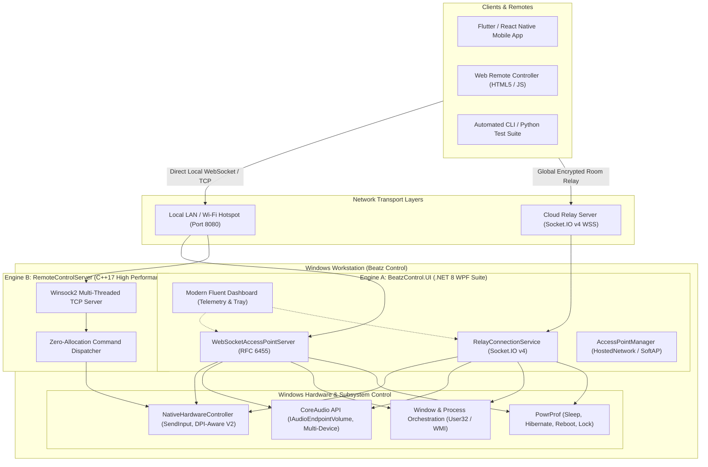

# Beatz Control — Professional Windows Remote Automation & Telemetry Suite

<div align="center">

  
  
  
  
  
  

  <p align="center">
    <b>Enterprise-grade, low-latency remote PC controller, system telemetry dashboard, and hardware automation platform.</b>
    <br />
    Seamlessly orchestrate your workstation locally over Wi-Fi / SoftAP hotspot or globally via encrypted cloud relay.
  </p>

  <p align="center">
    <a href="#-architecture-overview">Architecture</a> •
    <a href="#-key-features">Features</a> •
    <a href="#-dual-engine-ecosystem">Ecosystem</a> •
    <a href="#-network--protocol-specification">Protocols</a> •
    <a href="#-quick-start--installation">Quick Start</a> •
    <a href="#-building-from-source">Build</a> •
    <a href="#-mobile--client-sdks">Integration</a>
  </p>
</div>

---

## 🏛 Architecture Overview

Beatz Control provides a resilient, zero-overhead bridge between mobile clients/web remotes and Windows OS internals. Designed around a dual-engine architecture, it delivers both native high-throughput input synthesis and an asynchronous management runtime.



---

## 🌟 Key Features

### 🎮 Precision Input Simulation
- **Sub-Millisecond Mouse Synthesis**: Relative tracking, absolute coordinates, primary/secondary/middle clicks, double clicks, and drag-and-drop latching via `SendInput`.
- **Per-Monitor V2 DPI Awareness**: Dynamically handles mixed multi-monitor setups without virtual resolution clipping or cursor drift.
- **Accurate Keyboard & Hotkeys**: Scan code conversion, virtual keys (`F1`–`F24`, Modifiers), and multi-key combos (`HOTKEY CTRL+C`, `HOTKEY ALT+TAB`, `WIN+D`).
- **Layout-Agnostic Unicode Text**: Direct UTF-8 to UTF-16 character injection bypassing host keyboard language mismatches (`KEYEVENTF_UNICODE`).

### 📊 Real-Time Workstation Telemetry & System Control
- **Hardware Telemetry**: Real-time CPU utilization, RAM usage, storage consumption, and active battery metrics over WMI/PerformanceCounters.
- **Windows CoreAudio Control**: Granular volume adjustments, instantaneous hardware mute, and multi-endpoint switching.
- **Process & Window Orchestration**: Enumerate running windows, focus/minimize/maximize windows, bring applications to foreground, or safely terminate processes.
- **Power Management**: Direct Windows API calls for Workstation Lock, Sleep (`SetSuspendState`), Hybrid Hibernate, Reboot, and Shutdown.

### 🌐 Hybrid Connectivity Modes
- **Local Network & Hotspot Server**: Built-in RFC 6455 compliant WebSocket server and raw TCP socket server listening concurrently on port `8080`.
- **Global Cloud Relay**: Socket.IO v4 client bridging outbound connections to hosted relays (`https://backend-n4yg.onrender.com`), enabling remote control outside local subnets without NAT traversal or port forwarding.
- **Embedded Access Point Provisioner**: Programmatically configures Windows Hosted Network / Wi-Fi Hotspots for offline, ad-hoc peer-to-peer control.

---

## 📦 Dual-Engine Ecosystem

| Component | Technology | Primary Role | Best Used For |
| :--- | :--- | :--- | :--- |
| **`PCControl.UI`** | .NET 8 WPF, XAML, C# 12 | Rich GUI, telemetry dashboard, system tray, Relay client, WebSockets | End-user desktop execution, visual monitoring, multi-client routing |
| **`PCControl.Core`** | .NET 8 Class Library | P/Invoke layer, Audio endpoint controller, WebSocket AP engine, WMI telemetry | Core business logic, reusable runtime services, IPC |
| **`RemoteControlServer`** | Native C++17, Winsock2 | Ultra-lightweight raw TCP daemon (< 500 KB binary footprint) | Resource-constrained systems, headless embedded setups, zero-latency gaming/trackpad streams |
| **`Beatz Control Installer`** | Inno Setup 6 (LZMA2 Ultra) | Automated packaging, Windows Service hooks, Desktop shortcuts | Enterprise distribution, clean installation & uninstallation |

---

## 📡 Network & Protocol Specification

Beatz Control accepts plain-text newline-delimited TCP commands, JSON WebSocket packets, and Socket.IO events.

### 1. JSON WebSocket / Relay Schema (RFC 6455)

All frames sent to `ws://<host>:8080` or emitted via Socket.IO `command` events adhere to the following payload schema:

```json
{
  "type": "mouse_move" | "mouse_click" | "mouse_scroll" | "key_tap" | "key_combo" | "type_text" | "set_volume" | "system_action" | "window_focus",
  "dx": 0,
  "dy": 0,
  "button": "LEFT" | "RIGHT" | "MIDDLE",
  "state": "down" | "up",
  "delta": 120,
  "text": "Hello, World!",
  "key": "ENTER",
  "combo": "ctrl+shift+esc",
  "percent": 75,
  "action": "lock" | "sleep" | "shutdown" | "restart" | "mute"
}
```

### 2. Low-Latency Plaintext Stream Protocol

Sent over raw TCP (`RemoteControlServer.exe`), delimited by `\n` or `\r\n`:

| Command | Arguments | Description | Example Payload |
| :--- | :--- | :--- | :--- |
| `MOVE` | `<dx:int> <dy:int>` | Delta mouse movement | `MOVE 12 -8\n` |
| `SETPOS` | `<x:int> <y:int>` | Absolute cursor coordinates | `SETPOS 1920 1080\n` |
| `GETPOS` | *None* | Query mouse position | `GETPOS\n` $\rightarrow$ `OK 1920 1080` |
| `CLICK` | `[LEFT\|RIGHT\|MIDDLE]` | Mouse button single click | `CLICK LEFT\n` |
| `DBLCLICK` | `[LEFT\|RIGHT\|MIDDLE]` | Mouse double click | `DBLCLICK LEFT\n` |
| `DOWN` / `UP`| `[LEFT\|RIGHT\|MIDDLE]` | Latch button state (drag & drop) | `DOWN LEFT\n` ... `UP LEFT\n` |
| `SCROLL` | `<delta:int>` | Vertical scroll (multiples of 120) | `SCROLL 120\n` |
| `HSCROLL` | `<delta:int>` | Horizontal scroll | `HSCROLL -120\n` |
| `KEY` | `<key_name>` | Tap virtual key | `KEY ENTER\n`, `KEY ESC\n` |
| `HOTKEY` | `<k1>+<k2>[+<k3>]` | Execute key chord combination | `HOTKEY CTRL+ALT+DEL\n` |
| `TYPE` | `<text:string>` | High-fidelity Unicode text typing | `TYPE Production Deploy 🚀\n` |
| `MEDIA` | `<action>` | Standard media keys | `MEDIA PLAY`, `MEDIA VOL_UP` |
| `RESOLUTION` | *None* | Return primary display bounds | `RESOLUTION\n` $\rightarrow$ `OK 2560 1440` |
| `PING` | *None* | Heartbeat telemetry check | `PING\n` $\rightarrow$ `PONG` |

---

## 🚀 Quick Start & Installation

### Pre-Built Binary Deployment
Download the latest production installer from the Releases section or run the automated Inno Setup script:
1. Run `dist\BeatzControl_Setup_v2.0.0.exe`.
2. Follow the setup wizard to configure optional Windows Startup launch and Desktop shortcuts.
3. Launch **Beatz Control** from your Start Menu.
4. Scan the on-screen QR Code with the Mobile App or open `web_remote_controller.html` in your browser.

---

## 🛠 Building From Source

### Prerequisites
- **Operating System**: Windows 10 / Windows 11 (x64)
- **.NET SDK**: .NET 8.0 SDK or later (`dotnet --version`)
- **C++ Compiler**: Microsoft Visual Studio 2022 (with *Desktop development with C++*) or MSVC Build Tools
- **Optional**: Inno Setup 6 (to package the installer)

### 1. Build the .NET 8 Desktop & Core Solution
```powershell
# Restore dependencies and build Release configuration
dotnet build PCControl.sln -c Release

# Publish self-contained executable for distribution
dotnet publish PCControl.UI\PCControl.UI.csproj -c Release -r win-x64 --self-contained false -o dist\UI
```

### 2. Compile the Native C++ High-Performance Server
```cmd
# Execute the automated MSVC build pipeline
build.bat
```
*The compiled binary will be placed into `bin\RemoteControlServer.exe`.*

### 3. Package Production Installer (Inno Setup)
```cmd
"C:\Program Files (x86)\Inno Setup 6\ISCC.exe" installer\BeatzControl.iss
```

---

## 📱 Mobile & Client SDKs

Integrate Beatz Control into any mobile or desktop client in minutes:

````carousel
```dart
// Flutter / Dart (TCP & WebSocket)
import 'dart:io';
import 'dart:convert';

class BeatzRemote {
  Socket? _socket;

  Future<void> connect(String host, int port) async {
    _socket = await Socket.connect(host, port);
    _socket!.setOption(SocketOption.tcpNoDelay, true);
    _socket!.listen((data) => print("RX: ${utf8.decode(data)}"));
  }

  void moveCursor(int dx, int dy) => _socket?.write("MOVE $dx $dy\n");
  void click([String btn = "LEFT"]) => _socket?.write("CLICK $btn\n");
  void typeUnicode(String text) => _socket?.write("TYPE $text\n");
}
```
<!-- slide -->
```typescript
// TypeScript / React Native / Node.js
import WebSocket from 'ws';

class BeatzWebRemote {
  private ws: WebSocket;

  constructor(url: string = 'ws://192.168.1.50:8080') {
    this.ws = new WebSocket(url);
    this.ws.on('open', () => console.log('Connected to Beatz Workstation'));
  }

  send(payload: object) {
    this.ws.send(JSON.stringify(payload));
  }

  move(dx: number, dy: number) {
    this.send({ type: 'mouse_move', dx, dy });
  }

  volume(percent: number) {
    this.send({ type: 'set_volume', percent });
  }
}
```
<!-- slide -->
```swift
// Swift (iOS Network.framework)
import Network

class BeatzClient {
    private var connection: NWConnection?

    func connect(host: String, port: UInt16) {
        let endpoint = NWEndpoint.Host(host)
        let portEndpoint = NWEndpoint.Port(rawValue: port)!
        connection = NWConnection(host: endpoint, port: portEndpoint, using: .tcp)
        connection?.start(queue: .main)
    }

    func send(cmd: String) {
        let payload = (cmd + "\n").data(using: .utf8)!
        connection?.send(content: payload, completion: .idempotent)
    }
}
```
<!-- slide -->
```kotlin
// Kotlin (Android Sockets)
import java.io.PrintWriter
import java.net.Socket
import kotlin.concurrent.thread

class BeatzController(private val host: String, private val port: Int) {
    private var writer: PrintWriter? = null

    fun connect() {
        thread {
            val socket = Socket(host, port)
            socket.tcpNoDelay = true
            writer = PrintWriter(socket.getOutputStream(), true)
        }
    }

    fun triggerHotkey(chord: String) {
        thread { writer?.println("HOTKEY $chord") }
    }
}
```
````

---

## 🧪 Testing & Verification

Comprehensive Python integration scripts are bundled for validation and testing:

```bash
# Execute automated hardware input & response regression test suite
python test_client.py

# Test C# WebSocket server implementation
python test_csharp_websocket.py

# Launch interactive CLI remote shell
python test_client.py --interactive
```

---

## 🔒 Security & Safe Operation

- **Network Sandboxing**: When hosting via local Wi-Fi or SoftAP, bound listeners can be restricted to private subnets (`192.168.0.0/16`, `10.0.0.0/8`, `172.16.0.0/12`).
- **Cloud Relay Rooms**: Cloud relay sessions use dedicated Room IDs with ephemeral client token authentication to prevent unauthorized cross-room traffic.
- **Process Safeguards**: Hardware simulation requests run under the standard user token context and do not install invasive kernel drivers.

---

## 📄 License & Attribution

Distributed under the **MIT License**. See `LICENSE` for further details.  
Maintained by **Beatz** and the open-source engineering community.
